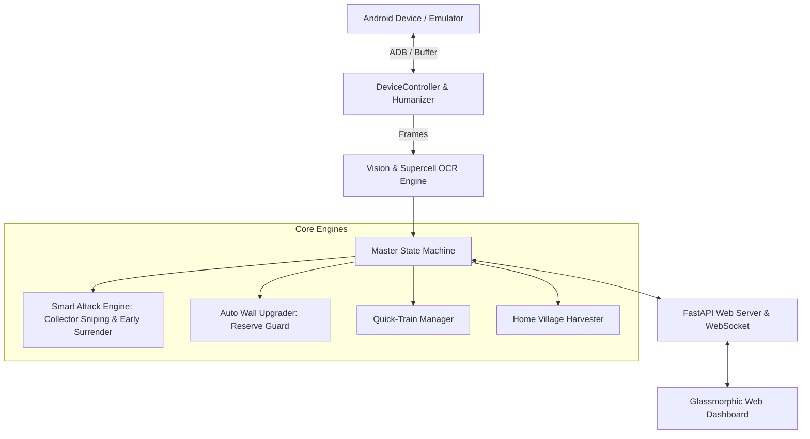

# ⚔️ AutoFarm CoC — Next-Gen Clash of Clans Automation

An intelligent, undetectable, high-performance personal automation engine for **Clash of Clans**. Built in modern Python with computer vision, Bézier humanized inputs, smart collector sniping, automated wall upgrading, and a sleek real-time web dashboard.

---

## 🌟 Why AutoFarm is Better than Public Bots (MoodBot / MyBot.run)

| Feature | Generic Public Bots (MoodBot / MyBot) | AutoFarm (This Project) |
| :--- | :--- | :--- |
| **Attack Intelligence** | Blind 4-finger spam or static coordinate drops that dump entire armies. | **Surgical Collector Sniping:** Identifies outer mines & collectors, drops 2-3 Sneaky Goblins per target right outside the red boundary, and **surrenders as soon as 85% loot is drained** (saves 70%+ army, allowing 4× more attacks/hr). |
| **Wall Upgrading** | Often rigid or risks depleting gold needed for upgrades. | **Smart Wall Dumper:** Only spends surplus resources strictly above configurable reserves (`reserve_gold: 1,500,000`). Upgrades single walls or clusters automatically. |
| **Anti-Detection** | Simple linear coordinate jitter easily flagged by server heuristics. | **Cubic Bézier Splines:** Human-like swipe curvature, Gaussian finger jitter, variable touch velocities, and realistic session fatigue breaks. |
| **Screen Capture & Speed** | Slow file-based screenshots (`screencap -p`). | High-speed direct buffer streaming (<30ms reaction latency) with automatic resolution scaling. |
| **User Interface** | Clunky Windows-only legacy GUIs. | **Glassmorphic Web Dashboard** with live video stream, real-time loot counters, terminal logs, and instant strategy controls. |
| **Simulation Mode** | Requires emulator running to even test a line of code. | **Built-in Mock Engine:** Includes a high-fidelity simulator to test vision, attack logic, and dashboard anytime without an emulator. |

---

## 🏗️ Architecture



---

## 🚀 Quick Start

### 1. Requirements
- Python 3.9+
- An Android Emulator (e.g., **MuMu Player Pro** on Mac, **LDPlayer** / **BlueStacks** on Windows) **OR** any physical Android device connected via USB with USB Debugging enabled.

### 2. Installation
```bash
# Navigate to AutoFarm
cd AutoFarm

# Activate virtual environment (already set up)
source .venv/bin/activate

# Install dependencies (if not already installed)
pip install -r requirements.txt
```

### 3. Running the Bot

#### Launch Web Dashboard (Recommended)
```bash
python3 main.py
```
This launches the server and opens `http://127.0.0.1:8080` in your default browser.

#### Launch with Mock Mode (Instant Testing without Phone/Emulator)
```bash
python3 main.py --mock
```

#### Run in Headless CLI Mode
```bash
python3 main.py --cli
```

---

## 📱 Connecting to Your Game

### Option A: Physical Android Phone (Most Undetectable)
1. Enable **Developer Options** and turn on **USB Debugging** on your Android phone.
2. Connect your phone via USB cable (or via ADB over Wi-Fi: `adb connect <phone_ip>:5555`).
3. Run `python3 main.py`. AutoFarm will automatically detect your phone serial and pair.

### Option B: Android Emulator (Mac or Windows)
- **MuMu Player Pro (Mac):** Enable ADB in Settings -> AutoFarm auto-connects to port `16384` or `5555`.
- **LDPlayer (Windows):** Enable ADB in Settings -> port `5555`.
- **BlueStacks:** Enable Android Debug Bridge in Preferences.

---

## 🎯 Smart Attack Configuration

In `config/config.yaml` or directly from the **Web Dashboard**:

```yaml
farming:
  min_gold: 450000         # Min gold before accepting a base
  min_elixir: 450000       # Min elixir before accepting a base
  min_dark_elixir: 3500    # Min dark elixir target
  max_skips: 120           # Max searches before returning home to rest

attack:
  strategy: "collector_snipe"       # Options: collector_snipe, barch_wave, full_assault
  preferred_troop: "sneaky_goblin"  # Sneaky Goblins are the fastest farming unit
  troops_per_collector: 3           # Drop 2-3 goblins directly at each outer mine
  early_surrender: true             # Stop attack immediately once 85% loot is obtained
  loot_depletion_threshold: 0.85    # Conserves troops for immediate next attack!
  stagnant_seconds: 7               # End if loot stops changing for 7 seconds

walls:
  enabled: true
  reserve_gold: 1500000             # Never spend below 1.5M (safe for upgrades/army)
  reserve_elixir: 1500000
  preferred_resource: "both"        # Spend whichever resource is in surplus
```

---

## 🧪 Running Automated Tests
```bash
.venv/bin/python3 -m unittest discover tests
```
All 6 core modules (Device, Vision, OCR, Collector Sniping, Wall Upgrading, and State Machine) have automated unit tests.
